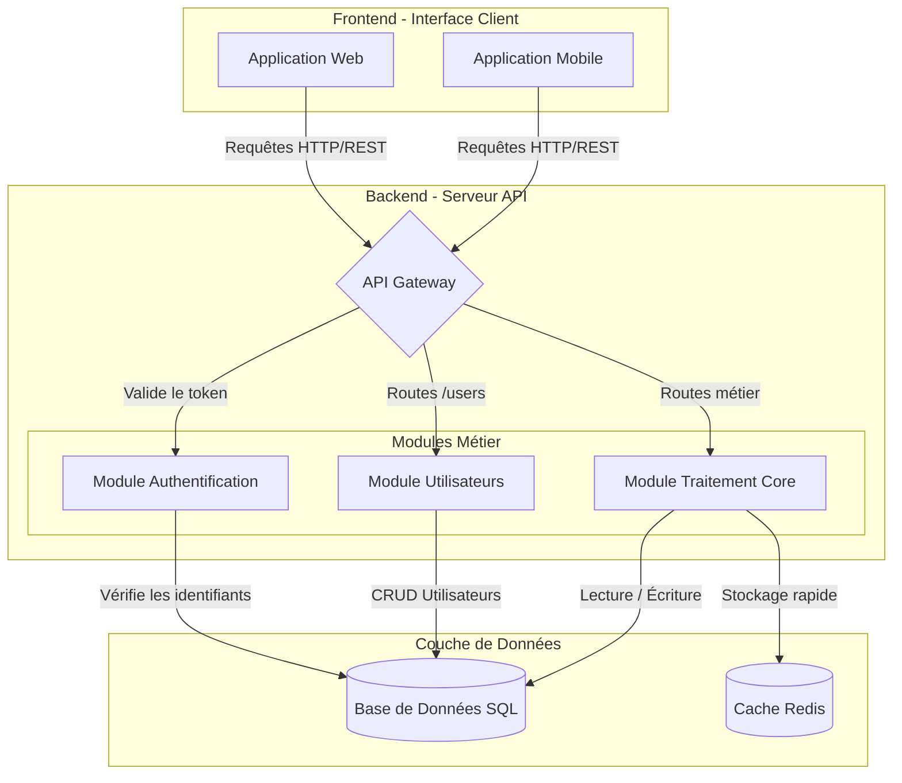

*This activity has been created as part of the 42 curriculum by ahalifa and bkuntz*

---
## ***Description***

This activity is about creating a pacman from a maze generator. 

---
## ***Instructions***

Makefile

| Commands    | Use                                 |
| ----------- | ----------------------------------- |
| all         | Default behavior see run            |
| run         | Run the script within the env       |
| debug       | Run debuger                         |
| clean       | Remove all cache file and venv      |
| lint        | Run flake8 and mypy                 |
| lint-strict | Run flake8 and mypy --strict        |
| tests       | Run Tests, see Test folder          |
| build ?     | make the build, see if needed later |

## ***Resources***

- [unittest](https://docs.python.org/3/library/unittest.html)
- [pygame](https://www.pygame.org/docs/)
### *Configuration*
---
### *Highscore*

### *Maze Generation*

The assigned packaged was used to randomly create mazes.
The level_1 is created with a seed (which one ?), the others are random
### *Implementation*

### *General Software Architecture*

### *Project management*

- [github](https://github.com/users/CrowHugin/projects/4)
